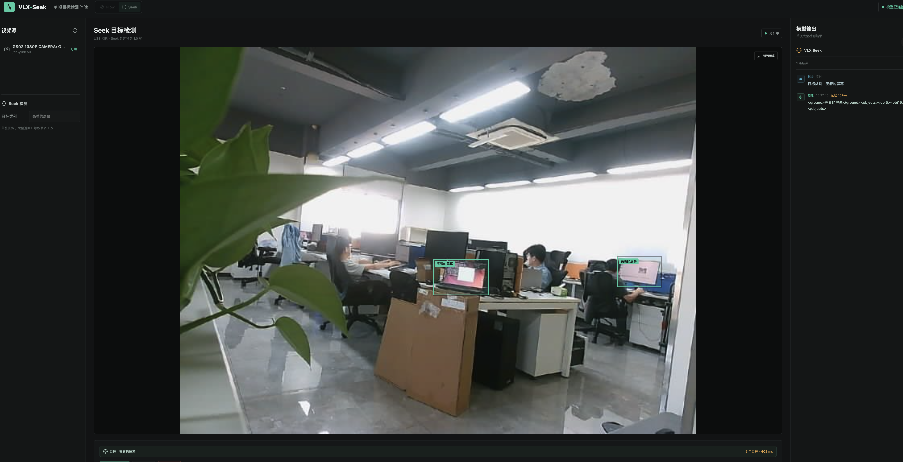

# VLX-Seek Studio

VLX-Seek 目标搜索模型的本地 Web 体验台。后端从 USB 相机采集单帧图像，通过 `omai` Python SDK 调用 VLX-Seek，前端实时显示检测文本与边界框。



## 本地开发

```bash
npm install
npm run dev
```

启动后端：

```bash
cd backend
python3 -m venv .venv
source .venv/bin/activate
pip install -r requirements.txt
uvicorn app.main:app --reload --port 8000
```

后端依赖会安装 PyPI 包 `omai==1.0.3`，并通过 `VlxApiClient.from_env()` 创建客户端。默认配置与 `docs/zh/3 算法应用开发/demo.py` 保持一致：

```bash
export VLX_API_ENABLED=true
export VLX_API_ENDPOINT=http://172.16.37.118:8000/os/
export VLX_API_KEY=YjI3YjM4OTQyZDczMjZkMWUzYTdAZVpHVWdxdzg=
export VLX_API_CONNECT_TIMEOUT_MS=60000
export VLX_API_READ_TIMEOUT_MS=60000
export VLX_API_WRITE_TIMEOUT_MS=60000
export SEEK_MODEL=vlx-seek-1.5-3b
```

还可通过 `SEEK_ANALYSIS_FPS` 和 `SEEK_PREVIEW_DELAY_MS` 调整检测频率与预览延迟。没有模型服务时可设置 `SEEK_MOCK=1`。

## Docker 部署

```bash
docker compose up --build
```

浏览器访问 `http://127.0.0.1:5173`。默认映射 `/dev/video0`，可通过 `VIDEO_DEVICE` 修改。SQLite 数据保存在 Compose 的 `seek-data` 卷中。
